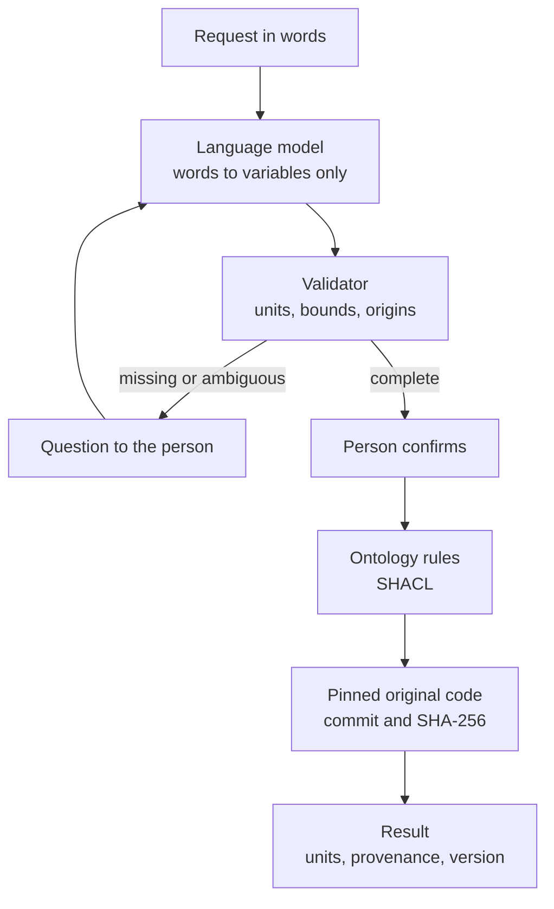
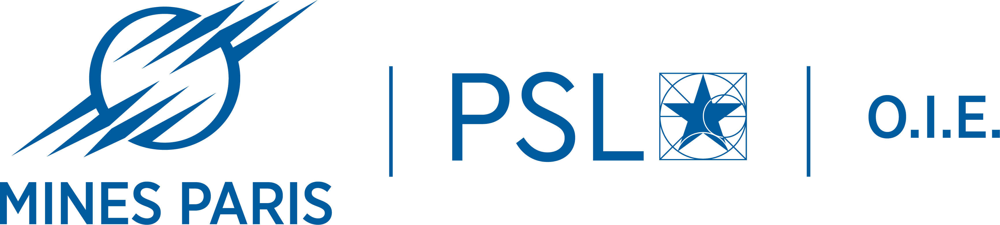

# WebSemantic

**Language models can prepare scientific simulations. WebSemantic makes sure they do not guess.**

[](https://doi.org/10.5281/zenodo.23238902)
[](https://pypi.org/project/websemantic/)
[](https://research-software-directory.org/software/websemantic)
[](https://www.bestpractices.dev/projects/15359)
[](LICENSE)
[](https://cyrilvoyant-websemantic.static.hf.space)

Ask a language model to run a simulation and it fills the gaps by itself. "A weak updraft" becomes 0.1 m/s, "the
usual dose" becomes 3 Gy, and the code runs on values that nobody stated. In our tests, such guesses changed the
computed result by up to a factor of 2.6, and moved a complication probability from 3 % to 47 %.

WebSemantic sits between the person, the language model and a validated scientific code. The model only translates
words into the code's variables. WebSemantic checks them, proposes the declared defaults and conventions, asks for
what is missing, and runs the original code only after the person agrees. Every result states its units, its
sources and the exact version of the code that produced it.

**Try it:** [cyrilvoyant-websemantic.static.hf.space](https://cyrilvoyant-websemantic.static.hf.space), free, nothing
to install, in English or French, on a computer or a phone.

## One description, four views

Each code is described once, in a descriptor ([example](descriptors/tls/descriptor.yaml)): its parameters, canonical
units, bounds, defaults, qualitative conventions and tasks. WebSemantic derives four artefacts from it, so they never
contradict each other.

| Artefact | What it holds | Used by |
|---|---|---|
| **Contract** ([LLM-CONTRACT.md](packs/tls/LLM-CONTRACT.md)) | Reading rules: what each parameter means, its unit, what may be assumed, what must be asked | Language models |
| **Ontology** ([core.ttl](ontology/core.ttl), [shapes.ttl](ontology/shapes.ttl)) | OWL and SKOS vocabulary aligned with QUDT and PROV-O; SHACL shapes that check a scenario | Validation, linked data |
| **Validator** | One decision per scenario: execute, clarify or refuse. It never fills in a value | Every run |
| **FAIR metadata** ([codemeta.json](codemeta.json), [CITATION.cff](CITATION.cff)) | Identity, licence, versions, persistent identifiers | Catalogues, citation |

**Software-agnostic.** Adding a code takes a descriptor and a thin adapter ([guide](docs/integrating-models.md)).
The code itself is never modified: it is pinned to a commit and its sources are checked by SHA-256 before each run.

**LLM-ready.** An agent that reaches this repository needs nothing else: [llm.md](llm.md) gives the rules and
[agent/run.py](agent/README.md) runs a code from an accepted scenario.

## From a request to a result



A number is accepted only if it appears in the person's words. A default or a convention is only proposed, and
counts once the person accepts it. In the web app, the SHACL check runs before every LQL-Equiv calculation; the TLS
parameters are not yet mapped to ontology concepts.

## Three codes, three domains

The three test cases were chosen to differ: a stochastic engineering model, a dose model with high stakes, and a
third-party physics code.

| Code | Domain | What it computes | Web app |
|---|---|---|---|
| [Tunnel Load Simulator](https://github.com/cyrilvoyant/tunnel-load-simulator) | Road tunnels | Electricity demand, Monte Carlo, up to one simulated year; comparison of tunnels | Yes |
| [LQL-Equiv](https://github.com/cyrilvoyant/LQL-Equiv-web) | Radiotherapy research | EQD2, BED, TCP and NTCP; schedule comparison, resumption after an interruption, maximum and minimum doses | Yes |
| [pyrcel](https://github.com/darothen/pyrcel) | Cloud physics | Adiabatic parcel, aerosol activation | Python route |

LQL-Equiv runs on fictitious scenarios for research and teaching. It is not a medical device and the practitioner
decides.

## Use it

**In the browser.** [The web app](https://cyrilvoyant-websemantic.static.hf.space) runs TLS and LQL-Equiv. A relay
keeps the language model's key private (Mistral); the codes themselves run in your browser. Each result can be
downloaded with its tables, its provenance and a local trace of the conversation. Source: [`webapp/`](webapp/).

**From your own agent.** Read [llm.md](llm.md), then [agent/README.md](agent/README.md). One command per code, no Git
and no key needed:

```sh
python agent/run.py tls scenario.json
python agent/run.py lql scenario.json
python agent/run.py pyrcel scenario.json
```

**On your computer.** Python 3.12+ and Git are needed; the terminal dialogue uses a `GEMINI_API_KEY`.

```powershell
git clone --recurse-submodules https://github.com/cyrilvoyant/websemantic.git
cd websemantic
python -m venv .venv
& .\.venv\Scripts\python.exe -m pip install -e ".[tls,atmosphere]"
& .\.venv\Scripts\python.exe -m websemantic.cli chat
```

On Windows, the packaged version installs with `Installer.cmd` and starts with `WebSemantic.cmd`
([guide](packaging/windows/Guide.txt)). More: [installation](docs/installation-windows.md),
[terminal dialogue](docs/terminal.md).

## What comes back

- **CSV tables**: time series, daily values, profiles and indicators, with their units.
- **manifest.json**: every parameter with its value, unit, origin, source and acceptance; software versions and
  commits; SHA-256 of inputs and outputs.
- **semantics.ttl**: the provenance as an RDF graph (PROV-O).

[TLS parameters and outputs](docs/tls-reference.md) · [JSON contract](ontology/tls-contract.json) ·
[Agent execution](docs/agent-contract.md)

## Evidence

The method was tested on 72 requests, each asked with eight combinations of documentation, contract, ontology and
FAIR metadata, three times, with four language models (frozen release 0.2.6; paper in preparation). Adding the
contract to the documentation reduced premature calculations from 26 to 6 % (Mistral-Small), 17 to 1 % (Qwen2.5),
52 to 23 % (Codestral) and 25 to 3 % (Gemini), and raised the correct handling of vague words from 0 to 30 % to
45 to 95 %. The ontology does more as a checker than as reading material for the model.

## For developers

Definitions live in the descriptors ([TLS](descriptors/tls/descriptor.yaml),
[LQL-Equiv](descriptors/lqlequiv/descriptor.yaml), [pyrcel](descriptors/pyrcel/descriptor.yaml)); the contracts,
ontology files and metadata are generated from them.

```powershell
& .\.venv\Scripts\python.exe -m pip install -e ".[dev,tls]"
& .\.venv\Scripts\python.exe -m pytest -q
& .\.venv\Scripts\python.exe -m ruff check src tests tools
```

[Architecture](docs/architecture.md) · [Adding a code](docs/integrating-models.md) · [All documentation](docs/README.md) ·
[Contributing](CONTRIBUTING.md) · [Security](SECURITY.md) · [Changelog](CHANGELOG.md)

## Cite and licence

Cite the concept DOI [10.5281/zenodo.23238902](https://doi.org/10.5281/zenodo.23238902) (all versions; see
[CITATION.cff](CITATION.cff)). Ontology namespace: [w3id.org/websemantic/ns](https://w3id.org/websemantic/ns).

[MIT](LICENSE) from version 0.2.6; versions 0.2.0 to 0.2.5 remain under PolyForm Noncommercial 1.0.0. The pinned
codes keep their own licences (TLS and LQL-Equiv: MIT; pyrcel: BSD-3-Clause). The repository holds no key.

<a href="https://www.oie.minesparis.psl.eu/"></a>

Cyril Voyant, Centre O.I.E. (Observation, Impacts, Energy), Mines Paris - PSL.
